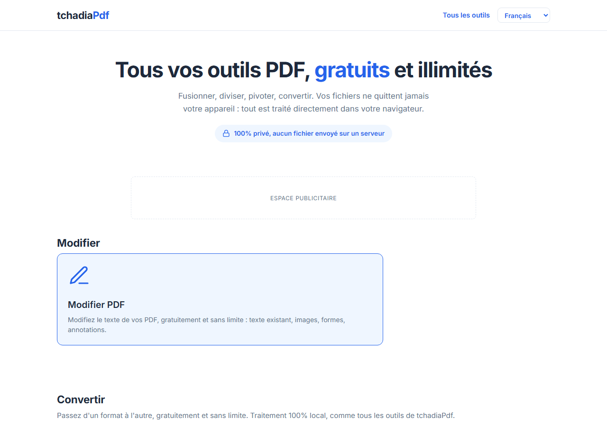
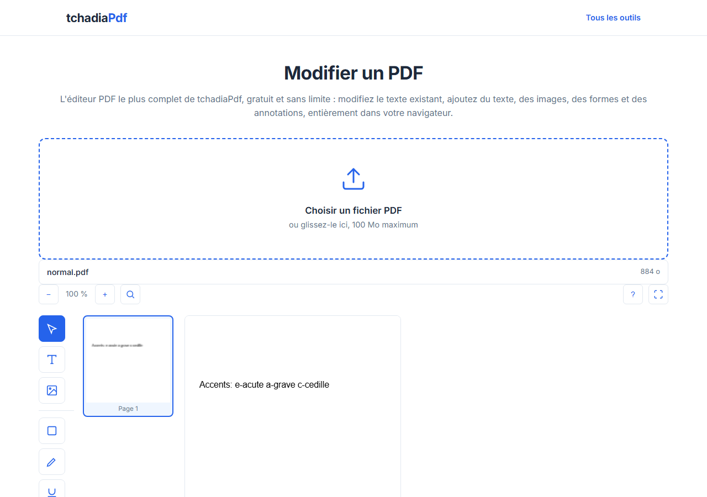

Français | [English](README.en.md)

<h1 align="center">tchadiaPdf</h1>

<p align="center">Boîte à outils PDF gratuite, illimitée et open source. Vos fichiers ne quittent jamais votre navigateur.</p>

<p align="center">
  <a href="LICENSE"></a>
  <a href="#les-43-outils-disponibles"></a>
  <a href="https://tchadiapdf.com"></a>
  <a href="CONTRIBUTING.md"></a>
  <a href="#contribuer"></a>
</p>

<p align="center"><a href="https://tchadiapdf.com"><strong>tchadiapdf.com</strong></a></p>

<p align="center"><em>Free, unlimited, open source PDF toolkit. Your files never leave your browser.</em></p>

## Aperçu





*Capture de l'éditeur prise dans son état actuel. Une refonte de l'interface (zones éditables affichées en pointillés, panneau de styles latéral) est en cours dans une branche séparée et sera reflétée ici une fois livrée.*

## Pourquoi tchadiaPdf

- **Gratuit sans limite** : pas de compte à créer, pas de quota journalier, aucune fonctionnalité réservée à une offre payante.
- **100% privé** : tout le traitement a lieu dans l'onglet de votre navigateur, aucun fichier n'est envoyé sur un serveur. L'absence de trafic réseau est vérifiée par un test automatisé qui intercepte toutes les requêtes pendant une conversion réelle : [tests/no-network-leak.spec.js](tests/no-network-leak.spec.js).
- **Open source** : code auditable sous licence MIT, contributions bienvenues.

## Les 43 outils disponibles

### Modifier

| Outil | Lien |
|---|---|
| Modifier PDF | [tchadiapdf.com/modifier-pdf.html](https://tchadiapdf.com/modifier-pdf.html) |

### Convertir

**Vers PDF**

| Outil | Lien |
|---|---|
| JPG en PDF | [tchadiapdf.com/jpg-en-pdf.html](https://tchadiapdf.com/jpg-en-pdf.html) |
| Word en PDF | [tchadiapdf.com/word-en-pdf.html](https://tchadiapdf.com/word-en-pdf.html) |
| Excel en PDF | [tchadiapdf.com/excel-en-pdf.html](https://tchadiapdf.com/excel-en-pdf.html) |
| PowerPoint en PDF | [tchadiapdf.com/powerpoint-en-pdf.html](https://tchadiapdf.com/powerpoint-en-pdf.html) |
| Texte en PDF | [tchadiapdf.com/texte-en-pdf.html](https://tchadiapdf.com/texte-en-pdf.html) |
| HEIC en PDF | [tchadiapdf.com/heic-en-pdf.html](https://tchadiapdf.com/heic-en-pdf.html) |
| WebP en PDF | [tchadiapdf.com/webp-en-pdf.html](https://tchadiapdf.com/webp-en-pdf.html) |
| TIFF en PDF | [tchadiapdf.com/tiff-en-pdf.html](https://tchadiapdf.com/tiff-en-pdf.html) |
| BMP en PDF | [tchadiapdf.com/bmp-en-pdf.html](https://tchadiapdf.com/bmp-en-pdf.html) |
| SVG en PDF | [tchadiapdf.com/svg-en-pdf.html](https://tchadiapdf.com/svg-en-pdf.html) |
| Markdown en PDF | [tchadiapdf.com/markdown-en-pdf.html](https://tchadiapdf.com/markdown-en-pdf.html) |
| HTML en PDF | [tchadiapdf.com/html-en-pdf.html](https://tchadiapdf.com/html-en-pdf.html) |
| EPUB en PDF | [tchadiapdf.com/epub-en-pdf.html](https://tchadiapdf.com/epub-en-pdf.html) |

**Depuis PDF**

| Outil | Lien |
|---|---|
| PDF en JPG | [tchadiapdf.com/pdf-en-jpg.html](https://tchadiapdf.com/pdf-en-jpg.html) |
| PDF en Word | [tchadiapdf.com/pdf-en-word.html](https://tchadiapdf.com/pdf-en-word.html) |
| PDF en Excel | [tchadiapdf.com/pdf-en-excel.html](https://tchadiapdf.com/pdf-en-excel.html) |
| PDF en PowerPoint | [tchadiapdf.com/pdf-en-powerpoint.html](https://tchadiapdf.com/pdf-en-powerpoint.html) |
| PDF en texte | [tchadiapdf.com/pdf-en-texte.html](https://tchadiapdf.com/pdf-en-texte.html) |

**Images**

| Outil | Lien |
|---|---|
| HEIC en JPG | [tchadiapdf.com/heic-en-jpg.html](https://tchadiapdf.com/heic-en-jpg.html) |
| PNG en JPG | [tchadiapdf.com/png-en-jpg.html](https://tchadiapdf.com/png-en-jpg.html) |
| JPG en PNG | [tchadiapdf.com/jpg-en-png.html](https://tchadiapdf.com/jpg-en-png.html) |
| SVG en PNG | [tchadiapdf.com/svg-en-png.html](https://tchadiapdf.com/svg-en-png.html) |

### Tous les autres outils

| Outil | Lien |
|---|---|
| Fusionner PDF | [tchadiapdf.com/fusionner.html](https://tchadiapdf.com/fusionner.html) |
| Compresser PDF | [tchadiapdf.com/compresser-pdf.html](https://tchadiapdf.com/compresser-pdf.html) |
| Diviser PDF | [tchadiapdf.com/diviser.html](https://tchadiapdf.com/diviser.html) |
| Faire pivoter PDF | [tchadiapdf.com/pivoter.html](https://tchadiapdf.com/pivoter.html) |
| Organiser PDF | [tchadiapdf.com/organiser-pdf.html](https://tchadiapdf.com/organiser-pdf.html) |
| Numéros de page | [tchadiapdf.com/numeros-de-pages.html](https://tchadiapdf.com/numeros-de-pages.html) |
| Filigrane | [tchadiapdf.com/filigrane.html](https://tchadiapdf.com/filigrane.html) |
| Rogner PDF | [tchadiapdf.com/rogner-pdf.html](https://tchadiapdf.com/rogner-pdf.html) |
| Protéger PDF | [tchadiapdf.com/proteger-pdf.html](https://tchadiapdf.com/proteger-pdf.html) |
| Réparer PDF | [tchadiapdf.com/reparer-pdf.html](https://tchadiapdf.com/reparer-pdf.html) |
| Déverrouiller PDF | [tchadiapdf.com/deverrouiller-pdf.html](https://tchadiapdf.com/deverrouiller-pdf.html) |
| Signer PDF (signature dessinée et signature numérique PAdES avec certificat .p12) | [tchadiapdf.com/signer-pdf.html](https://tchadiapdf.com/signer-pdf.html) |
| OCR PDF | [tchadiapdf.com/ocr-pdf.html](https://tchadiapdf.com/ocr-pdf.html) |
| Formulaires PDF | [tchadiapdf.com/formulaires-pdf.html](https://tchadiapdf.com/formulaires-pdf.html) |
| Comparer PDF | [tchadiapdf.com/comparer-pdf.html](https://tchadiapdf.com/comparer-pdf.html) |
| Scanner un document | [tchadiapdf.com/scanner-pdf.html](https://tchadiapdf.com/scanner-pdf.html) |
| Aplatir PDF | [tchadiapdf.com/aplatir-pdf.html](https://tchadiapdf.com/aplatir-pdf.html) |
| Métadonnées PDF | [tchadiapdf.com/metadonnees-pdf.html](https://tchadiapdf.com/metadonnees-pdf.html) |
| Extraire les images | [tchadiapdf.com/extraire-images-pdf.html](https://tchadiapdf.com/extraire-images-pdf.html) |
| Livret PDF | [tchadiapdf.com/livret-pdf.html](https://tchadiapdf.com/livret-pdf.html) |

## Technologies

tchadiaPdf est un site 100% statique : HTML, CSS et JavaScript sans framework ni étape de build. Le traitement des fichiers se fait entièrement côté client, avec ces bibliothèques (détail complet des versions et licences dans [DEPENDENCIES.md](DEPENDENCIES.md)) :

- [pdf-lib](https://github.com/Hopding/pdf-lib) : lecture, écriture et assemblage de documents PDF
- [pdf.js](https://github.com/mozilla/pdf.js) : rendu des pages et extraction du texte existant
- [Tesseract.js](https://github.com/naptha/tesseract.js) : reconnaissance de texte (OCR) pour les PDF scannés
- [qpdf](https://qpdf.readthedocs.io/) compilé en WebAssembly ([qpdf-wasm](https://github.com/neslinesli93/qpdf-wasm)) : chiffrement AES-256 et réparation de PDF corrompus

D'autres bibliothèques ciblées (mammoth.js, SheetJS, docx, pptxgenjs, html2canvas, marked, epub.js, UTIF.js, heic2any, JSZip) prennent en charge les outils de conversion, chargées uniquement quand l'outil correspondant en a besoin. Deux traitements sont déportés dans un Web Worker pour ne pas bloquer l'interface : la recompression d'images de Compresser PDF (`js/compresser-pdf.worker.js`) et l'analyse DOCX de Word en PDF.

## Lancer en local

Le site est statique : aucune installation n'est nécessaire pour le consulter, seulement un serveur HTTP local (un simple double-clic sur les fichiers ne suffit pas, les Web Workers ont besoin d'une origine http/https).

1. Clonez le dépôt :
   ```bash
   git clone git@github.com:YOSO98/tchadiaPDF.git
   ```
2. Servez le dossier avec un serveur statique, par exemple :
   ```bash
   npx http-server -p 8080
   # ou
   python -m http.server 8080
   ```
3. Ouvrez `http://localhost:8080` dans votre navigateur.

### Lancer les tests

La suite de tests [Playwright](https://playwright.dev/) se trouve dans `tests/`.

```bash
npm install
npx playwright test
```

## Contribuer

Les contributions sont bienvenues : nouvel outil, traduction, correction de bug ou amélioration de la documentation. Consultez [CONTRIBUTING.md](CONTRIBUTING.md) pour les règles du design system (deux couleurs seulement, blanc et bleu) et la marche à suivre pour ajouter un outil. La participation au projet est régie par le [Code de conduite](CODE_OF_CONDUCT.md).

Deux façons simples d'aider :

- **Signaler un bug** : ouvrez une [issue sur GitHub](https://github.com/YOSO98/tchadiaPDF/issues).
- **Proposer un outil ou une traduction** : la page d'accueil est disponible en 5 langues (français, anglais, espagnol, portugais, arabe) ; traduire une page d'outil ou en ajouter une nouvelle sont de bonnes premières contributions.

## Soutenir le projet

tchadiaPdf est gratuit et le restera. Le projet pourra à l'avenir être financé par de la publicité (déjà prévue dans le code, désactivée tant que l'utilisateur n'a pas donné son consentement) et par des dons. Voir la page [Soutenir tchadiaPdf](https://tchadiapdf.com/soutenir.html) pour le détail.

- [Faire un don ponctuel sur Ko-fi](https://ko-fi.com/souleman)
- [Devenir sponsor sur GitHub Sponsors](https://github.com/sponsors/YOSO98)

## Licence

Projet distribué sous licence [MIT](LICENSE).

## Remerciements

tchadiaPdf s'appuie sur ces bibliothèques open source : pdf-lib, pdf.js, JSZip, mammoth.js, SheetJS, docx, pptxgenjs, html2canvas, marked, epub.js, UTIF.js, heic2any, Tesseract.js, @pdf-lib/fontkit et @neslinesli93/qpdf-wasm, ainsi que les polices Inter et Liberation Fonts. Détail complet des versions et des licences dans [DEPENDENCIES.md](DEPENDENCIES.md).
